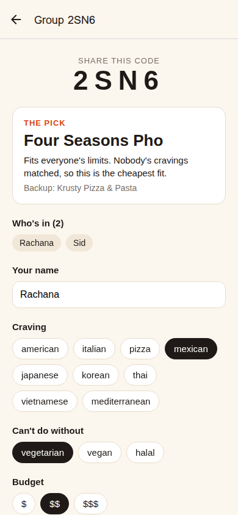

# Pick4Us

Pick4Us picks one restaurant a whole group can agree on.

One person starts a group and shares a 4-letter code. Everyone joins on their phone and taps what they are craving, what they can't eat (vegetarian, vegan, halal) and their budget. Pick4Us removes every place that breaks someone's limits or budget, ranks the rest by how many people are craving them, and shows one pick, a backup and the reason. Screens update live as people respond.

## Why

While doing customer discovery for Kalisi, I interviewed 20+ people who find food on social media. Food preferences turned out to be a bigger pain point than expected, especially in groups. Pick4Us is a small attempt at solving that.



## How it works

- **Expo** (React Native) for the app, in `src/app`
- **Convex** for the backend, in `convex/`. `getPick` is a query, so when someone submits, every phone in the group gets the new pick by itself.
- No accounts. You are identified by name inside a group, and submitting again replaces your answer.
- The pick logic is in `convex/pickLogic.ts`, with tests in `tests/pick.test.ts`.

The restaurant list is about 15 real places near Santa Clara University, in `restaurants.jsonl`. Dietary tags reflect menus, not allergy safety.

## Run it

```bash
npm install
```

```bash
npx convex dev
```

The first time, this asks you to log in to Convex and creates a deployment. Then load the restaurants:

```bash
npx convex import --table restaurants restaurants.jsonl
```

In a second terminal:

```bash
npm start
```

Scan the QR code with Expo Go, or press `w` for the web version. Run the pick tests with `npx tsx tests/pick.test.ts`.

Built with help from an AI coding agent.
